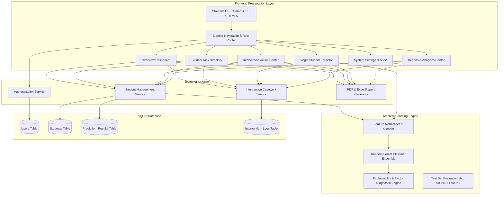

# 🎓 EduGuard AI – AI-Powered Student Dropout Risk Prediction & Early Intervention System

> **Tagline:** *Predict Early. Intervene Smartly. Protect Every Future.*

---

## 📌 Executive Summary

**EduGuard AI** is an enterprise-grade AI analytics and retention management platform designed for universities, colleges, and educational institutes. By synthesizing multi-dimensional academic, engagement, and financial indicators—specifically **Attendance Percentage**, **Cumulative GPA (CGPA)**, **LMS Platform Engagement**, and **Pending Fee Dues**—the system leverages an ensemble **Random Forest Classifier** to proactively classify student attrition risk into **Low Risk**, **Medium Risk**, and **High Risk**.

Unlike passive dashboard prototypes, EduGuard AI features complete full-stack database persistence (SQLite), role-based access control, an integrated **Early Intervention Action Center**, real-time individual prediction engines, explainable AI factor breakdowns, and high-fidelity multi-format reporting in **PDF**, **Excel (.xlsx)**, and **CSV**.

---

## 🏗️ Architecture & System Topology



---

## 💻 Technology Stack

| Domain | Technology / Library | Role & Purpose |
| :--- | :--- | :--- |
| **Frontend Framework** | `Streamlit 1.32+` | Responsive web interface, reactive session state, dynamic controls |
| **Custom Styling** | `HTML5`, `CSS3` | Modern SaaS design system: Vibrant Blue, Royal Purple, Teal, Risk Badges |
| **Backend & Ingestion**| `Python 3.13`, `Pandas`, `NumPy` | Data pipelines, column fuzzy mapping, aggregations, vectorization |
| **Machine Learning** | `Scikit-Learn`, `Joblib` | Random Forest Classifier, class balance weighting, stratified test evaluation |
| **Data Visualization** | `Plotly Express & Graph Objects` | Donut charts, threshold scatter plots, grouped bars, confusion matrix |
| **Database Engine** | `SQLite 3` | Relational persistence with foreign keys and cascading integrity |
| **Export Engines** | `FPDF2`, `OpenPyXL` | High-fidelity institutional PDF reports and multi-sheet Excel workbooks |

---

## 🧠 Machine Learning Model & Performance

The retention classification engine is powered by an optimized **Random Forest Classifier** trained on stratified student academic trajectories:

- **Features Utilized:**
  1. `Attendance Rate (%)` – Weight: **43.2%** (Dominant regulatory factor)
  2. `Cumulative GPA (0–10)` – Weight: **27.8%** (Academic capability factor)
  3. `Pending Fee Dues ($)` – Weight: **20.3%** (Financial stress factor)
  4. `LMS Activity Score (%)` – Weight: **8.7%** (Digital engagement factor)
- **Target Classes:**
  - `Low Risk` (🟢 Green Badge)
  - `Medium Risk` (🟡 Amber Badge)
  - `High Risk` (🔴 Red Badge)
- **Evaluation on Stratified Test Set (360 Students):**
  - **Overall Accuracy:** `90.56%`
  - **Weighted Precision:** `90.81%`
  - **Weighted Recall:** `90.56%`
  - **Weighted F1-Score:** `90.64%`
- **Explainability:** Each prediction computes multiclass probabilities ($P_{low}, P_{medium}, P_{high}$), a continuous Attrition Risk Index ($0-100$), and highlights natural-language contributing factors alongside personalized remedial advisories.

---

## 👥 Multi-Tier User Roles & Demo Credentials

The platform enforces strict role-based access control (RBAC):

| Role | Default Username | Password | Key Permissions |
| :--- | :--- | :--- | :--- |
| **👑 Institutional Administrator** | `admin` | `admin123` | Full access: CRUD students, batch CSV ingestion, model retraining, DB maintenance, institutional reports |
| **🎓 Student Support Counselor** | `counselor` | `counselor123` | View directory, predict risk, assign casework, log and update interventions, export dossiers |
| **👨‍🏫 Department Faculty** | `prof_sharma` | `faculty123` | Inspect cohort risk distributions, evaluate students, generate advisories |

> ⚡ **Quick Demo Sign-In:** The login page includes one-click demo login buttons for instant evaluation without manual typing.

---

## 🚀 Key Modules Walkthrough

### 1. 📊 Executive Overview Dashboard
- **6 Dynamic KPI Metric Cards:** Total Monitored, High-Risk (danger red), Medium-Risk (warning amber), Low-Risk (emerald green), Institutional Average Attendance, and Average CGPA.
- **Urgent High-Risk Alert Banner:** Direct notice of students requiring immediate retention outreach.
- **Interactive Visualizations:**
  - Risk Proportion Donut Chart with live student counter.
  - Attendance vs. CGPA Scatter Plot with 75% attendance line and 5.0 CGPA warning threshold.
  - Department-wise Grouped Risk Analysis.
  - Multi-Semester Historical Progression Line Chart.
  - Explainable AI Feature Importance Horizontal Bar Chart.

### 2. 📋 Student Risk Directory
- Real-time search by Student ID, Name, or Email.
- Multi-factor filtering (Risk Level, Academic Department) and flexible sorting.
- Interactive Student Profile Diagnostic Modal showing factor progress bars and prior counseling cases.
- In-place record editing with real-time ML risk re-calculation.
- Single-student enrollment and Administrator-only deletion safeguards.
- Administrator Batch CSV Ingestion with column normalization and template download.
- One-click export to **CSV** and **Excel (.xlsx)**.

### 3. 🎯 Single Student Risk Predictor
- Dual-mode prediction: Test prospective/hypothetical scenarios OR pre-fill from enrolled students.
- Interactive input sliders for Attendance, CGPA, LMS Activity, and numeric Fee Dues.
- Instant model prediction displaying:
  - Big visual Attrition Risk Index (0–100) with color-coded risk badge.
  - Horizontal Multiclass Probability Breakdown Chart.
  - Granular factor breakdowns (e.g. Critical attendance warning, financial arrear indicator).
  - Recommended Remedial Intervention Plan.
  - Direct shortcuts to save/enroll into SQLite or immediately launch an intervention case.

### 4. 🛡️ Early Intervention Action Center
- Case management desk for student retention officers and academic counselors.
- 4 Status metric cards: Total Cases, Active In Progress, Scheduled Pending, and Completed Cases.
- Multi-tab layout:
  - **Active Cases & Log History:** Filter by status, inspect counselor case notes, update case progress, and record follow-up logs.
  - **Initiate New Intervention Case:** Priority-ordered student dropdown, automated advisory generator, counselor assignment, category selection (Academic Counseling, Attendance Improvement, Financial Assistance, Personal Guidance, Academic Mentoring), and follow-up date picker.
  - **High-Risk Priority Queue:** Fast-track list of urgent students needing immediate casework.

### 5. 📑 Reports & Analytics Center
- **Institutional Risk Audit:** High-level summary with departmental cross-tabulation.
- **High-Risk Action Dossier:** Dedicated priority report.
- **Individual Student Dossier Generator:** Printable single-student comprehensive diagnostic dossier.
- **ML Model Performance & Audit:** Verifiable test set accuracy, weighted precision/recall/F1, Confusion Matrix Heatmap, and model architecture metadata.
- **One-Click Exports:**
  - 📄 Professional Multi-Page **PDF Reports** (via FPDF2)
  - 📊 Formatted Multi-Sheet **Excel Workbooks** (via OpenPyXL)
  - 📋 Raw **CSV Datasets**

### 6. ⚙️ System Settings & Administration
- User Profile overview and notification preferences.
- Secure Password Update with salted SHA-256 validation.
- Live ML Model Retraining Trigger: Re-trains Random Forest on new data and updates artifacts.
- Database statistics (record counts, file size) and one-click demo data reset.

---

## 📂 Project Structure

```
EduGuard_AI/
│
├── app.py                      # Main application entry point, session router & sidebar
├── requirements.txt            # Python dependencies
├── README.md                   # Comprehensive documentation
├── sample_students.csv         # Standalone CSV dataset with 120 student records
├── dropout_model.pkl           # Trained model artifact (legacy compatibility)
│
├── assets/
│   ├── styles.css              # Custom SaaS stylesheet (vibrant blue, purple, teal palette)
│   └── branding.py             # Vector SVG logo and branded HTML badges
│
├── backend/
│   ├── __init__.py
│   ├── database.py             # SQLite connection, schema creation & seeding
│   ├── authentication.py       # Salted SHA-256 password hashing & user validation
│   ├── student_service.py      # Student CRUD, queries, batch ingestion & aggregations
│   └── intervention_service.py # Intervention logs, case statuses & advisory workflows
│
├── ml/
│   ├── __init__.py
│   ├── preprocessing.py        # Feature extraction, column fuzzy matching & clipping
│   ├── train_model.py          # Synthetic dataset generator, RF training & evaluation
│   ├── predict.py              # Single & batch inference, probabilities & factor explanation
│   └── model_evaluation.py     # Metrics access, confusion matrix & feature importances
│
├── utils/
│   ├── __init__.py
│   ├── charts.py               # Plotly charts with custom corporate styling
│   ├── helpers.py              # HTML KPI cards, risk badge pills & formatters
│   └── report_generator.py     # Multi-page PDF and multi-sheet Excel generation
│
├── views/
│   ├── __init__.py
│   ├── login_view.py           # Login interface with quick demo credential chips
│   ├── dashboard_view.py       # Executive overview dashboard with 6 KPIs & 5 charts
│   ├── student_directory_view.py # Student table, search, filters, CRUD & CSV upload
│   ├── predictor_view.py       # Single student predictor with interactive sliders
│   ├── intervention_view.py    # Intervention Action Center & case management
│   ├── reports_view.py         # Multi-format reports, PDF/Excel downloads & model audit
│   └── settings_view.py        # Profile, change password, retraining & DB tools
│
└── data/
    ├── eduguard.db             # SQLite database storing users, students, predictions, logs
    ├── model_artifacts.joblib  # Serialized Random Forest model, metrics & metadata
    └── sample_students.csv     # Pre-seeded student records
```

---

## 🛠️ Installation & Execution Guide

### Prerequisites
- Python 3.10, 3.11, 3.12, or 3.13 installed.
- Git (optional, for cloning).

### 1. Setup Virtual Environment (Recommended)
```bash
# Clone or navigate to the project directory
cd "Dropout System"

# Create a virtual environment
python -m venv venv

# Activate the virtual environment
# On Windows PowerShell:
.\venv\Scripts\Activate.ps1
# On macOS / Linux:
source venv/bin/activate
```

### 2. Install Dependencies
```bash
pip install -r requirements.txt
```

### 3. Initialize & Train the Model (Automated)
The application will automatically initialize the SQLite database, seed 120 students, and load the pre-trained Random Forest model on first launch. If you wish to explicitly run the training pipeline:
```bash
python ml/train_model.py
```

### 4. Launch the Web Application
```bash
streamlit run app.py
```
Open your browser and navigate to:
```
http://localhost:8501
```

Sign in using one of the demo accounts (`admin` / `admin123` or `counselor` / `counselor123`) or click the quick demo login chips on the login page!

---

## ☁️ Deployment on Render (Render Web Services)

EduGuard AI is pre-configured for seamless cloud deployment on [Render](https://render.com/).

### Method 1: 1-Click Blueprint Deployment (Recommended)
This repository contains a pre-configured `render.yaml` infrastructure-as-code file.
1. Push this repository to your **GitHub** or **GitLab** account.
2. Log in to [Render Dashboard](https://dashboard.render.com/).
3. Click **New +** and select **Blueprint**.
4. Connect your EduGuard AI repository.
5. Render reads `render.yaml` automatically and configures the web service, build steps, start command, and environment variables.
6. Click **Apply** to deploy!

---

### Method 2: Manual Web Service Setup
If creating the Web Service manually via the Render UI:

1. **Create Web Service:**
   - In Render Dashboard, click **New +** > **Web Service**.
   - Connect your EduGuard AI GitHub/GitLab repository.

2. **Configure Service Settings:**
   | Setting | Value |
   | :--- | :--- |
   | **Name** | `eduguard-ai` *(or your preferred name)* |
   | **Language / Runtime** | `Python 3` |
   | **Region** | Select closest region (e.g. `Oregon (US West)` or `Frankfurt (EU)`) |
   | **Branch** | `master` *(or `main`)* |
   | **Root Directory** | Leave empty *(root directory)* |
   | **Build Command** | `pip install -r requirements.txt` |
   | **Start Command** | `streamlit run app.py --server.address 0.0.0.0 --server.port $PORT --server.headless true` |
   | **Instance Type** | `Free` *(or Starter)* |

3. **Configure Environment Variables:**
   Under the **Environment Variables** section, add:
   | Key | Value | Purpose |
   | :--- | :--- | :--- |
   | `PYTHON_VERSION` | `3.11.9` | Locks the exact Python runtime version |
   | `STREAMLIT_SERVER_HEADLESS` | `true` | Ensures Streamlit runs smoothly without browser prompts |
   | `STREAMLIT_BROWSER_GATHER_USAGE_STATS` | `false` | Disables telemetry prompts |

4. **Click "Deploy Web Service"**:
   - Render runs `pip install -r requirements.txt`
   - Render injects dynamic `$PORT` (e.g. `10000`)
   - The application starts with `streamlit run app.py --server.address 0.0.0.0 --server.port $PORT --server.headless true`
   - EduGuard AI boots up, initializes SQLite, verifies/trains the Random Forest model, and provides your live public URL: `https://eduguard-ai.onrender.com`.

---

### 🔑 Demo Accounts for Render Live Testing

Once deployed on Render, log in using any of the following pre-configured institutional roles:

- **👑 Administrator:** `admin` / `admin123` (Full system access, upload datasets, CRUD students, retrain ML models)
- **🎓 Counselor:** `counselor` / `counselor123` (Directory, prediction, early intervention casework)
- **👨‍🏫 Faculty:** `prof_sharma` / `faculty123` (View student risk, generate academic advisories)

*(You can also use the one-click demo login buttons directly on the login page!)*

---

## 🛡️ License & Academic Integrity
Developed as a production-grade educational technology solution for student retention analytics. Distributed under the MIT License.
